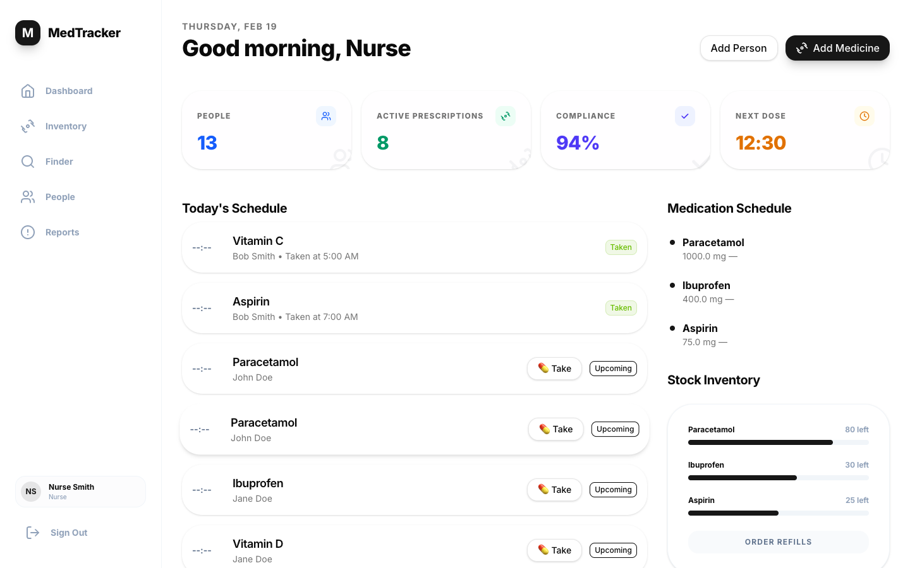

# MedTracker

[](https://github.com/damacus/med-tracker/actions/workflows/ci.yml)
[](https://github.com/damacus/med-tracker/releases)
[](LICENSE)

MedTracker is an open-source, self-hosted medication tracker for individuals,
families, and carers. It supports household medication schedules, dose
recording, stock tracking, reminders, and auditable history.

> [!IMPORTANT]
> MedTracker is currently in beta. It should supplement your
> existing medication routine. Do not depend on it for clinical decisions,
> emergency information, or your sole medication reminders, and do not use it
> as a replacement for established care.



## Why MedTracker?

Medication management is rarely just a list of pills. When care is shared,
families need to know what is due, what has already happened, whether supplies
are running low, and who recorded each action. MedTracker brings that context
together without handing control of it to a hosted service.

- See today's medication routine for everyone you care for in one place
- Replace uncertainty about a dose with a clear history
- Spot low stock before it becomes a last-minute problem
- Coordinate care for children, dependent adults, and other household members
- Keep an attributable record of who did what and when
- Run MedTracker on infrastructure you control

## Migration checkout

This branch makes Loco 1.2 the root Rust application and retains Rails under
`rails/` as read-only reference code. The foundation currently exposes
`/up`, framework database readiness at `/_health`, and a Tera landing page.
The accepted fresh Rust architecture is recorded in
[ADRs 0013–0016](docs/design.md#accepted-rust-direction). These decisions do not
certify implementation acceptance.

Root Rust builds need ICU 78 (`brew install icu4c@78` on macOS).
Ubuntu 26.04 CI already provides ICU 78; Task commands supply its environment.

Use `task deps` once to resolve dependencies, `task build` to compile and `task ci`
to verify Loco. Set `DATABASE_URL` to a dedicated PostgreSQL 18 database and run
`task dev`. Startup does not migrate, truncate or recreate the product schema.
`task db:migrate MIGRATION_DATABASE_URL=...` creates the complete schema in an
empty database. `task db:prepare SEED_DATABASE_URL=...` also loads synthetic
development fixtures. These commands use privileged setup credentials; the
application uses its restricted runtime role. Existing database adoption is not
supported. `task release-image` remains guarded. Do not point foundation
verification at a live database. See [database setup](docs/testing.md#loco-database-setup).

## Try the Rails self-hosted beta

We are looking for technically confident self-hosters to run MedTracker and try
the journey from household setup to recording doses. Tell us where the app is
confusing or unreliable.

For a private local evaluation:

```shell
git clone https://github.com/damacus/med-tracker.git
cd med-tracker
npm install -g portless
portless trust
task rails:dev:portless
task rails:dev:seed
```

Open <https://med-tracker.localhost>. Development seed data contains sample
accounts with known passwords, so never expose a seeded development instance
to a public or shared network.

Read the [self-hosting guide](https://damacus.github.io/med-tracker/self-hosting/)
before starting, and use the
[deployment guide](https://damacus.github.io/med-tracker/deployment/) for a
production-style installation.

## Share feedback

GitHub is the main home for MedTracker feedback:

- [Start a Discussion](https://github.com/damacus/med-tracker/discussions) for
  questions, early impressions, and self-hosting help
- [Report a bug or request a feature](https://github.com/damacus/med-tracker/issues/new/choose)
  using the short guided forms
- [Report a security vulnerability privately](https://github.com/damacus/med-tracker/security/advisories/new)

Please do not include names, medication details, health information, credentials,
tokens, or unredacted logs in public issues or discussions.

## Client Tools

First-party Rust tools live under `client-tools/`:

- `medtracker`: CLI for `/api/v1` workflows.
- `medtracker-mcp`: stdio MCP server for agent clients.

Run local tool gates with `task client-tools:fmt`,
`task client-tools:check`, `task client-tools:clippy`, and
`task client-tools:test`.

## Documentation

Published docs: <https://damacus.github.io/med-tracker/>

Key pages:

- [Quick Start](https://damacus.github.io/med-tracker/quick-start/)
- [Glossary](docs/glossary.md)
- [LLM Context Index (llms.txt)](https://damacus.github.io/med-tracker/llms.txt)
- [Kubernetes User Seeding](https://damacus.github.io/med-tracker/kubernetes-user-seeding/)
- [Record a First Dose](docs/families/taking-first-dose.md)
- [Testing](https://damacus.github.io/med-tracker/testing/)
- [Client Tools](docs/api/client-tools.md)
- [Design](https://damacus.github.io/med-tracker/design/)
- [User Management](https://damacus.github.io/med-tracker/user-management/)

### Build docs locally

```fish
task docs:serve
```

## Contributing

See [CONTRIBUTING.md](CONTRIBUTING.md) for setup instructions, development
workflow, and coding standards.

## Synthetic Loco canary

The release binary includes `task canary-capabilities`, `task canary-seed` and
`task canary-smoke`. Use `--environment production` with the dedicated canary
configuration. Ordinary production `db seed` remains disabled. Mount the dedicated
production YAML supplied by [HomeOps #4578](https://github.com/damacus/home-ops/pull/4578)
at `/app/config/production.yaml`; it enables stubbed mail and omits `queue.reaper`.
Enabling canary mode against the stock production configuration deliberately
fails closed. The ordinary production queue reaper stays unchanged.

Canary settings must explicitly enable the scope `medtracker-canary`, use the
`medtracker_canary` database and a separate `medtracker_canary_control` database
on `medtracker-canary-rw.medtracker-canary.svc.cluster.local`, and select an
immutable image digest. Set `MEDTRACKER_CANARY_SMOKE_KEY` independently from
session, signing and database credentials. The reset controller supplies
`MEDTRACKER_CANARY_RUN_ID` and `MEDTRACKER_CANARY_EPOCH`. No SMTP delivery, push
credentials, S3 configuration, provider sign-in or AI calls are permitted.

The seed embeds synthetic fixtures, including `persistence@example.test` with
password `password`, two selectable households, an unrelated household, an adult
and a child with a guardian declaration, stock, treatments, a schedule, dose
history and a reminder intent. It refuses populated or unrecognised databases.
A completed matching-image seed is a no-op. The completion marker commits only
with the entire graph. Stock currently requires a storage label in the app.

HTTP requests require the matching ready image. During fresh verification only
requests carrying the internal smoke key pass the gate; ordinary authentication
and household permissions still apply. Read-only `/health` probes also pass
during fresh verification so Kubernetes can mark the server ready for the smoke
journey. Health remains unavailable when the control phase or heartbeat is unsafe.
Workers and scheduled tasks remain paused until verification succeeds and the
control phase is `ready`. Canary configuration must omit the optional queue reaper so
it cannot reclaim a live waiting handler. After a worker dies, recover its
Processing jobs with Loco's native requeue command only after confirming the old
worker has stopped, or allow the next weekly reset to replace the queue.
Ordinary production retains its existing reaper setting. Canary pages display a
persistent synthetic-data warning, last completed reset, next reset and countdown
in Europe/London time. The read-only `/canary/status` response contains only
`phase`, `last_success` and `next_reset`.
The smoke task signs in through the normal endpoint, checks both households,
records a dose, checks stock and replay, and verifies unrelated-household denial.
Set `MEDTRACKER_CANARY_SMOKE_URL` to
`http://medtracker-canary.medtracker-canary.svc.cluster.local:5150`.

Run `task test:canary` for disposable PostgreSQL coverage of the seed, control-only
capability check, configuration refusals, full application boot and HTTP journey.
This test is also part of `task ci`. These local checks do not authorise a rollout
or prove live access through ingress or network policies.
