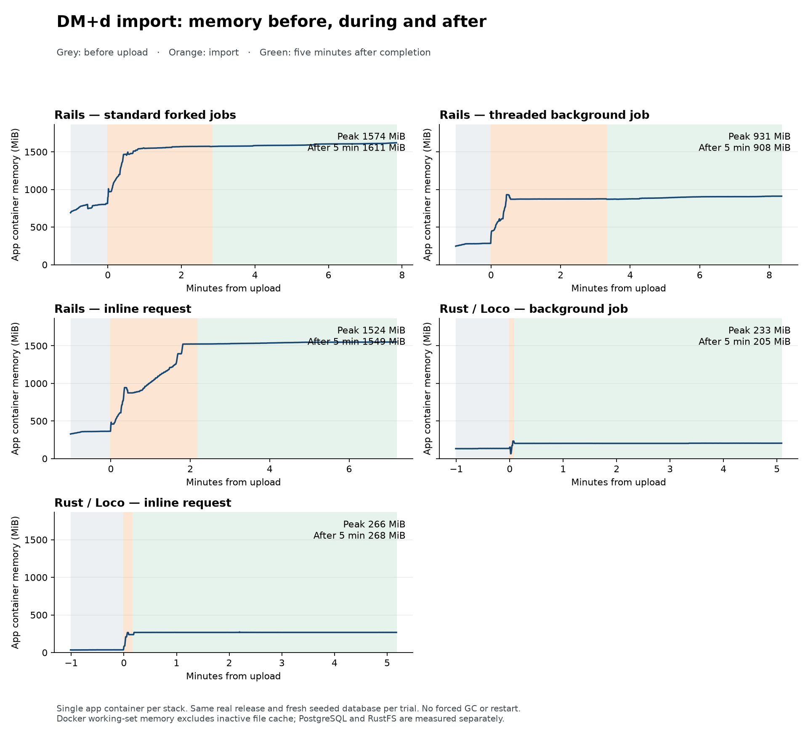
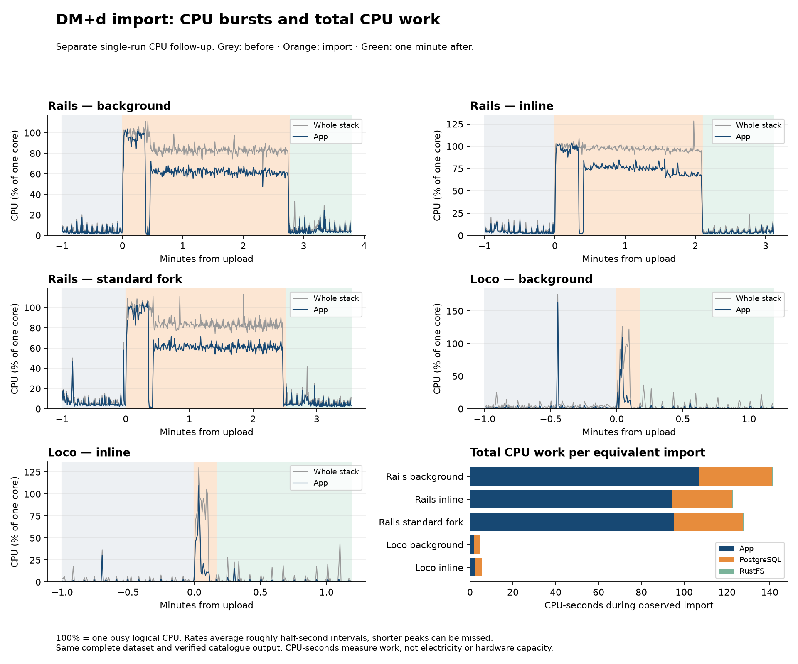

# Rails and Loco runtime comparison — 23 October 2026

This local experiment investigates memory use on modest hardware. It compares the
specific application images and deployment modes below. It does not establish
concurrent-user capacity, energy consumption or a general language advantage.

The host was macOS with native ARM64 Linux application images in Docker Desktop.
The Docker VM had four logical CPUs and 8,320,299,008 bytes of memory; Engine
version was 29.8.2. Application containers had no individual CPU quota. Host/VM
overhead and unrelated workloads are outside the container totals.

## Import memory and completion time

Measured locally on 23 October 2026. All five cases use one application container, one PostgreSQL container and one RustFS container. No Mailpit. Each import uses a fresh clone of its framework’s seeded database, the same native application image within each framework and the same real DM+d release.

Rails retains substantially more memory after this import in both threaded background and inline modes. Keeping import work in a separate worker protects the web process from retaining those allocations. This single-container experiment measures that consolidation cost; it does not measure the exact production layout with a separate web container and async worker.

| Application configuration | Before (MiB) | Peak during import (MiB) | Five minutes after (MiB) | Observed completion (s) |
|---|---:|---:|---:|---:|
| Rails / Puma + standard forked Solid Queue | 786.8 | 1574.4 | 1611.3 | 171.3 |
| Rails / Puma + threaded Solid Queue | 278.6 | 930.9 | 908.3 | 201.6 |
| Rails / inline import | 359.8 | 1524.5 | 1549.3 | 131.6 |
| Loco / background import | 134.8 | 233.3 | 204.6 | 5.6 |
| Loco / inline import | 35.9 | 266.3 | 267.6 | 10.6 |

Before is the median over 60 seconds following successful login and ten dashboard warm-up requests. After is the median of the final minute of a five-minute observation window. No explicit garbage collection or restart occurred within those windows. Import time includes HTTP upload, queue dispatch and completion polling at five-second intervals; short runs therefore have coarse timing. Each configuration ran once, so these are observations, not a statistical throughput benchmark.

The forked Rails baseline was still rising during its pre-import minute (about 691 to 814 MiB). Its before value is therefore a measured warm-up baseline, not a fully settled idle figure. Without an idle-only control, its entire before-to-after increase cannot be attributed to the import. The previously recorded settled idle forked Rails result is in the earlier idle results below.

Memory is Docker working-set usage: cgroup usage less inactive file cache. It includes every process in the application container, including scheduled task subprocesses and forked job workers. It is not process RSS. File-cache charging differs between trials, so anonymous memory is reported below to expose that effect. All cases had the same 3 GiB application memory limit.

| Configuration | Anonymous before (MiB) | Anonymous five minutes after (MiB) | Whole stack before (MiB) | Whole stack peak during (MiB) | Whole stack after (MiB) |
|---|---:|---:|---:|---:|---:|
| Rails / Puma + standard forked Solid Queue | 721.9 | 1568.0 | 1095.1 | 2275.6 | 1908.8 |
| Rails / Puma + threaded Solid Queue | 276.4 | 896.0 | 541.7 | 1711.8 | 1193.3 |
| Rails / inline import | 292.4 | 1481.7 | 640.9 | 1842.9 | 1861.1 |
| Loco / background import | 34.1 | 201.4 | 321.0 | 520.4 | 517.2 |
| Loco / inline import | 34.8 | 214.3 | 317.7 | 575.7 | 572.3 |

Whole-stack values sum simultaneous application, PostgreSQL and RustFS samples. Database containers were reused between fresh database clones, so their cache state can carry across runs. The application-only measurements and anonymous-memory figures are the clearer comparison of retained importer memory.

All imports completed successfully with 288,565 processed records, 84,410 created barcodes, 187,213 AMPP relationships and 16,942 skips. Ordered content hashes of all imported business fields match across all five cases; generated IDs and timestamps are excluded. Supplementary trade-family tables are empty on both sides because that optional supplement is absent from this release. The same synthetic household, account, person, location, medicine and treatment were present before every trial.

Dataset: the complete local September 2026 DM+d release XML files and nested week 40 GTIN archive, repacked without documentation and XSDs. Expanded data is 228,220,965 bytes; the shared ZIP is 16,607,265 bytes. ZIP SHA-256: `36bf248199088229c5107061403c3a0a2e896a55d0e9e79088201bfad540d6c9`.

The import used each application’s real authenticated administrator upload endpoint and native job. Rails threaded and forked cases use Solid Queue; Rails inline changes only NhsDmdImportJob’s adapter through a guarded temporary initializer. Loco changes BackgroundQueue to ForegroundBlocking. Web, workers and scheduler remain enabled. Rails inline retains the ordinary threaded Solid Queue infrastructure for other jobs.

The live Ironstone worker has no liveness, readiness or startup probe. Web probes call `/up`; the local benchmark likewise uses HTTP health requests and does not launch `rails runner`. Production does run `bin/rails db:prepare` in an init container for both deployments, which boots Rails once during startup. This is separate from ongoing worker memory. Production checks were read-only.

The standard Rails case uses this repository’s default Puma Solid Queue fork mode; the threaded case sets SOLID_QUEUE_SUPERVISOR_MODE=async. Production already uses async in a separate worker (`bin/jobs --mode async`), so the fork-to-thread reduction is not a newly available production saving.

A process snapshot shortly after the forked import located most of the growth in the default job worker: about 235 MiB RSS before and 825 MiB afterwards; Puma was about 393 MiB afterwards. These individual RSS figures include shared pages and must not be added to obtain a container total. This supports the reason for separating a heavy importer from the web process. [Before processes](runtime-benchmark-2026-10-23/rails-fork/processes-before.txt), [after processes](runtime-benchmark-2026-10-23/rails-fork/processes-after.txt).

## Dashboard responsiveness observations

Health requests run roughly once per second, with an authenticated dashboard request every five seconds. This tests basic responsiveness during import, not concurrent-user capacity. The table below covers only dashboard requests during the original import trials; it does not combine health endpoints or include before/after windows. Lower elapsed time is better.

| Configuration | Dashboard probes during import | Failed dashboard probes | Dashboard latency summary (ms) |
|---|---:|---:|---:|
| Rails / Puma + standard forked Solid Queue | 34 | 0 | Sampled p95: 91.7 |
| Rails / Puma + threaded Solid Queue | 40 | 0 | Sampled p95: 246.8 |
| Rails / inline import | 26 | 0 | Sampled p95: 792.0 |
| Loco / background import | 2 | 0 | Maximum of two samples: 52.1 |
| Loco / inline import | 2 | 0 | Maximum of two samples: 269.3 |

The earlier p95 label on the two Loco rows overstated what those samples can
show. The nearest-rank calculation was correct, but with two samples it selects
the maximum and cannot establish tail latency. The raw measurements are unchanged.

Dashboard responses were not uniformly faster in Loco. The comparable
threaded/background modes give the following before/after observations, all
with zero failed requests:

| Trial and phase | Rails dashboard requests | Rails sampled p95 (ms) | Loco dashboard requests | Loco sampled p95 (ms) |
|---|---:|---:|---:|---:|
| Original: before import | 13 | 63.5 | 12 | 109.1 |
| Original: five minutes after import | 59 | 100.6 | 59 | 150.1 |
| Hard 1 GiB: before import | 13 | 163.0 | 12 | 113.4 |
| Hard 1 GiB: five minutes after import | 60 | 155.8 | 59 | 172.0 |

These after values cover the entire five-minute probe window, not the final
minute used for retained-memory medians. The original before and both after
windows show worse Loco dashboard p95 observations. The bounded before window
shows the opposite direction. The small before samples, single sequential runs
and shared-VM/cache conditions prevent a repeatable regression or improvement
claim. Health-check timings are separate and do not resolve dashboard latency.

Calculation: sort recorded elapsed seconds within each phase and endpoint,
select the nearest rank `ceil(0.95 * n)` and convert to milliseconds. The
original report script includes elapsed durations for failed probes as well as
successes; there were no failures in the original table or these before/after
groups. A client timeout duration is not a completed server response time.
The bounded during-import timeouts are therefore reported separately in the
[matched-trial appendix](#matched-one-gib-rails-async-follow-up), rather than
hidden inside a successful-response percentile. The underlying per-case
`probes.jsonl.gz` files retain every request, phase, endpoint, outcome and duration.

The measurements show a substantial resource advantage for the tested Loco implementation on this import and support the goal of reducing operating memory. They do not quantify migration cost versus benefit: feature coverage, operational behaviour and maintenance cost remain separate questions. Retained memory is not by itself evidence of a leak; these runs contain no heap profile or forced-GC investigation.

This also compares importer implementations. The Rails importer finds or initialises and saves each barcode separately; the current Rust source builds batched inserts. The timing difference must not be attributed entirely to the programming language. A Rails importer changed to batch database writes was not tested here. See [Rails persistence](https://github.com/damacus/med-tracker/blob/1de893e64c88e652dfafdd56927b0f20eebf9feb/rails/app/services/nhs_dmd/release_import.rb#L180) and [Rust persistence](https://github.com/damacus/med-tracker/blob/1de893e64c88e652dfafdd56927b0f20eebf9feb/src/models/nhs_dmd/import.rs#L1004).

Both measured application images are native ARM64. Rails was built from checkout 1de893e64c88e652dfafdd56927b0f20eebf9feb. Loco uses the existing 22 October release image with only a temporary `/bin/sh` addition so Loco 1.2 scheduled tasks run. A latest-source Rust rebuild was cancelled while the shared Docker VM was under severe memory pressure; the audit below separates that build incident from runtime import memory. These results do not claim to measure that unbuilt source. Ruby / Rails / Solid Queue versions are 4.0.7 / 8.1.4 / 1.7.0.

Production also differs in using persistent disk uploads, Thruster, separate web/worker containers with 1 GiB limits, PostgreSQL HA and backups. This experiment deliberately gives both apps matching S3-compatible upload storage and a single PostgreSQL instance. It is a controlled local comparison of the requested single-container modes, not a replica of production.

The repository and HomeOps configuration were not edited. Existing databases and volumes were retained. No publication or deployment occurred.

Evidence: [numeric results](runtime-benchmark-2026-10-23/results.csv), [content verification](runtime-benchmark-2026-10-23/catalogue-verification.json), [sampling script](runtime-benchmark-2026-10-23/run_trial.py), [async configuration](runtime-benchmark-2026-10-23/compose-async.json), [inline configuration](runtime-benchmark-2026-10-23/compose-inline.json), [standard fork configuration](runtime-benchmark-2026-10-23/compose-fork.json). Each case directory contains raw half-second samples, HTTP probes, image identities and completion counters.

After every measurement window and evidence capture finished, both local stacks were restarted in async mode against their imported trial-A databases. Both passed health checks, sign-in and authenticated dashboard requests. That restart is outside the reported memory observations.

## Earlier settled idle measurements

These separate idle-only runs used the same synthetic application seed and three
containers per stack, without user HTTP traffic during sampling. They preceded
the DM+d import trials and had no application memory limit. Each window contains
24 Docker CLI snapshots about five seconds apart. They are not interchangeable
with the one-minute pre-import warm-up baseline.

| Container or total | Loco | Rails, forked jobs | Rails, threaded jobs |
|---|---:|---:|---:|
| Application, workers and scheduler (MiB) | 43.05 | 975.70 | 314.60 |
| PostgreSQL (MiB) | 55.15 | 113.20 | 107.80 |
| RustFS (MiB) | 65.62 | 73.64 | 73.59 |
| Whole stack, simultaneous median (MiB) | 164.43 | 1,162.74 | 495.84 |

Loco's settled idle memory above is from the second window. Its first-window
whole-stack median was 162.06 MiB. Native DM+d S3 storage configuration was added
for the later import trials. Production's separate async worker was already in
use; the local fork-to-thread reduction is not a new production saving.

The saved idle snapshots also contain CPU readings. In Docker's convention,
100% means one logical CPU fully used; values can exceed 100% across cores.

| Idle window | Loco app median / peak | Rails app median / peak | Loco whole-stack median | Rails whole-stack median |
|---|---:|---:|---:|---:|
| Rails forked | 0.84% / 1.35% | 4.15% / 9.19% | 2.86% | 5.15% |
| Rails threaded | 0.88% / 9.77% | 2.69% / 5.61% | 3.51% | 4.25% |

Loco's app median is lower in these windows, but its scheduled tasks produce
brief CPU spikes. Its observed peak is not always lower. Database and storage
activity narrow the difference when comparing whole stacks. These sparse idle
samples do not measure total CPU-seconds or the import's peak CPU.

## Evidence and reproduction boundary

The sibling evidence directory contains numerical summaries, compressed raw
samples and probes, image/container identities, catalogue hashes, the chart and
the sampling/client scripts. The release archive itself is not committed.
Database contents contain synthetic application fixtures; no production data
was used or copied. Runtime credentials in the configuration snapshots are
synthetic benchmark credentials, not deployment secrets.

Compose snapshots replace machine-specific bind mounts with `${WORKSPACE}` and
`${BENCHMARK_DIR}`. Scripts use `/tmp/medtracker-benchmark` in place of the
original scratch directory. These preserve the measured settings but are not a
one-command benchmark harness: reproduction needs the recorded images, the
matching real dataset, freshly seeded native databases with restricted runtime
roles and platform-admin fixtures, queue/cache/cable databases for Rails and an
initialised S3 bucket. Do not point them at a populated user database or reset
one to recreate a trial.

The memory capture saved working-set and anonymous/file-cache counters every
roughly half-second, but did not persist CPU counters during imports. Import CPU
must come from a separately labelled follow-up, rather than being inferred from
memory or wall time. No manual Rust optimisation was performed for these trials;
the Rust image is a release build, which already includes compiler optimisation.

## Separate CPU follow-up

These are new runs on 23 October using fresh seeded database clones, the same
dataset, images, application modes and four-CPU Docker VM. They do not replace
the original memory observations. The CPU runs use a 60-second pre-import window
and a 60-second post-completion window, with the same light HTTP probes. Each
mode was run once. Catalogue content hashes match across all five CPU trials
and the original memory trials. All applications completed without an OOM.

Docker Engine cumulative CPU nanoseconds were captured for each application,
PostgreSQL and RustFS container about every half-second. CPU-seconds are counter
differences over the observed import window, including queue/upload overhead,
routine jobs, HTTP probes and up to five seconds of completion-polling delay.
Idle baseline CPU has not been subtracted. Peak is the highest sampled interval
rate, not an instantaneous hardware peak. Shorter spikes can be averaged out.

| Configuration | Observed import (s) | App peak (% of one core) | App CPU-seconds | PostgreSQL CPU-seconds | RustFS CPU-seconds | Whole-stack CPU-seconds |
|---|---:|---:|---:|---:|---:|---:|
| Rails, threaded async | 167.1 | 103.1% | 106.68 | 34.32 | 0.44 | 141.44 |
| Rails, inline | 126.7 | 103.6% | 94.56 | 27.79 | 0.32 | 122.67 |
| Rails, standard fork | 152.0 | 105.7% | 95.36 | 32.27 | 0.39 | 128.02 |
| Loco, background | 10.7 | 109.8% | 1.78 | 2.84 | 0.12 | 4.74 |
| Loco, inline | 10.7 | 109.7% | 2.18 | 3.39 | 0.12 | 5.69 |

In this follow-up, Loco's background import consumed about 97% less whole-stack
CPU time than threaded Rails, and its inline import consumed about 95% less than
Rails inline. Its sampled application peaks were slightly higher, around 110%
of one core versus 103–106% for Rails. The app spent about 1–2 seconds above half
a core during import, compared with 121–159 seconds for Rails. The observed gain
is a much shorter busy period and less total CPU time, not a consistently lower
peak. These percentages describe the single measured runs and implementations.

One CPU-second is one logical core busy for one second. Total CPU-seconds per
completed equivalent import measures CPU work more usefully than peak CPU or
wall time alone. A shorter, higher parallel burst can use fewer CPU-seconds.
This does not measure electricity, thermal behaviour, latency under sustained
load or capacity on a different machine. No manual Rust tuning was applied;
these remain release-build implementations with different persistence strategies.

| Configuration | Before: app median | During: mean app CPU | During: app above 50% of one core (s) | After: app median | During: whole-stack peak |
|---|---:|---:|---:|---:|---:|
| Rails, threaded async | 2.96% | 63.9% | 159.43 | 3.90% | 111.5% |
| Rails, inline | 3.64% | 74.6% | 121.12 | 3.18% | 128.4% |
| Rails, standard fork | 4.22% | 62.8% | 143.28 | 4.11% | 113.2% |
| Loco, background | 0.84% | 16.8% | 1.01 | 0.57% | 126.1% |
| Loco, inline | 0.09% | 20.5% | 2.10 | 0.08% | 130.0% |

Before/after CPU readings above include light health/dashboard traffic and are
not the earlier quiet idle-only windows. The threshold duration sums sampled
intervals above 50%, so it is not an exact CPU scheduling trace. Four fully busy
cores would report about 400% in this convention. PostgreSQL cache state was
reused across freshly cloned databases, and these were sequential single trials.
PostgreSQL counters cover the entire container, including maintenance of retained
benchmark databases; they are not counters for one database or SQL statement.

[CPU numerical results](runtime-benchmark-2026-10-23/cpu/results.json) and
[CPU catalogue verification](runtime-benchmark-2026-10-23/cpu/catalogue-verification.json)
are stored with compressed raw counters, probes and the analysis script. Both
original imported stacks were restored to async mode after the CPU trials.

## One-GiB runtime follow-up

The same release image completed the same real import under a hard **1 GiB**
application-container limit, with **zero swap allowance**, zero OOM events and
zero restarts. This is a separate, single local trial using a fresh native seeded
database clone. Catalogue business-field hashes match every earlier trial.

The temporary Compose settings are `mem_limit: 1g`, `memswap_limit: 1g` and
`restart: no`. Docker inspect reported Memory=MemorySwap=1,073,741,824 bytes;
because MemorySwap is the combined RAM-plus-swap budget, this leaves no swap.
The kernel confirmed `memory.max=1073741824` and `memory.swap.max=0`.

The measured container runs `start --all --environment production`: web,
in-process background jobs and scheduler share that single 1 GiB budget, including
scheduled-task subprocesses. PostgreSQL and RustFS retain their earlier settings
and are outside that limit. Their recorded Docker memory limits are both zero
(unset): neither supporting container had an individual memory cap. The trial
therefore bounds only the application, not the whole stack. Historical kernel
swap limits for those supporting containers were not captured. No rebuild or
application change was needed.

| Phase | Working set (MiB) | Anonymous (MiB) | File cache (MiB) | Inactive file cache (MiB) | Raw cgroup usage (MiB) |
|---|---:|---:|---:|---:|---:|
| Before: median | 65.4 | 36.4 | 28.6 | 0.8 | 66.2 |
| During: highest working-set sample | 250.8 | 210.9 | 258.3 | 227.1 | 477.9 |
| Five minutes after: final-minute median | 242.2 | 189.0 | 51.9 | 0.2 | 242.4 |

The kernel high-water mark (`memory.peak`) over container startup, warm-up, import and retention was **482.3 MiB raw cgroup memory**. This includes inactive file cache and must not be compared directly with the working-set peaks in the earlier tables.

Observed upload/queue/import completion took **5.6 seconds**, with the same five-second completion-polling caveat. The import processed 288,565 records and produced the same 84,410 barcodes and 187,213 AMPP relationships, with 16,942 skips.

Kernel events at the end were `max=0`, `oom=0`, `oom_kill=0`; Docker reported `OOMKilled=false`, exit code 0, running=true and restart count 0. Swap usage was 0 bytes.

All 365 observed HTTP probes returned 200, including 6 probes during import. These light health/dashboard requests establish basic responsiveness, not capacity under user load. No forced GC or restart occurred during observation.

Loco remains running under this one-GiB limit against the newly imported clone;
the benchmark Rails app was restored after observation. Both passed health,
password sign-in and authenticated dashboard checks. Older databases are retained.

This proves that this combined local application completed this workload within
1 GiB without swap. It does not measure a separate web container plus a separate
worker container, establish their aggregate memory budget, or describe a deployed
Rust production topology. Build memory is a separate resource budget.

[Bounded Compose snapshot](runtime-benchmark-2026-10-23/one-gib/compose-1g.json),
[completion and OOM evidence](runtime-benchmark-2026-10-23/one-gib/completion.json)
and [phase summary](runtime-benchmark-2026-10-23/one-gib/summary.json) are retained
alongside raw samples, probes, kernel-limit readings and Docker events.
The retrospective Docker event query returned no records; zero OOM events are
established by the kernel counters and Docker state, not that empty event file.

## Audit of the earlier build-pressure incident

The earlier statement that a Rust build exhausted the 8 GB VM was too broad.
Retained records support severe pressure during a release build on a shared VM;
they do not show that the application/import needed 8 GB or that one build alone
accounted for every byte. No historical kernel OOM is established.

- BuildKit records this benchmark’s release build at revision `1de893e64` from
  **09:42:48 to 10:06:25 BST on 23 October**, ending as `canceled` with
  `context canceled`. The retained task log ends with exit status 130 and matches
  the explicit cancellation command. This is not an observed runtime OOM.
- At 09:50 BST, the VM snapshot reported 8,125,292 KiB total RAM, 620,732 KiB
  available (about 606 MiB), and nearly all 1,048,572 KiB of swap in use.
- At 09:53 BST, the VM process snapshot showed `rustc` PID 88417 at roughly
  **3.4 GiB RSS**, with cargo, Ruby, PostgreSQL, Kubernetes and other processes
  also resident. The saved snapshots do not prove that compiler’s cgroup ownership
  or provide a complete per-workload memory ledger.
- Retained BuildKit history shows this benchmark’s Rails build overlapping for
  about 87 seconds, ending at 09:44:18 BST, before those pressure snapshots.
  No other build overlaps the later pressure period in that builder’s history.
  This cannot exclude compilation outside that builder or other VM activity.
- After cancellation, a snapshot reported about **4.2 GiB available memory**.
  That is consistent with the release build being a major contributor, while
  remaining insufficient to attribute all VM pressure exclusively to it.
- The recorded Task invoked `docker build` without a memory-limit flag; the
  Dockerfile defaulted to two Cargo build jobs. The effective historical BuildKit
  cgroup limit was not captured and cannot be reconstructed from the runtime
  container limit. A Compose service memory limit does not constrain that build.

[Cancelled-build metadata](runtime-benchmark-2026-10-23/one-gib/cancelled-build-metadata.json)
and [overlapping build records](runtime-benchmark-2026-10-23/one-gib/overlapping-builds.json)
are retained with the original build log and compressed contemporaneous diagnostic
tool outputs. The diagnostic timestamps are preserved; these are recovered
historical observations, not a new recreation of the build failure.

## Matched one-GiB Rails async follow-up

Rails also completed the same import under a hard **1 GiB app-container limit
with no swap**, with no OOM and no restart through five minutes of retention.
This trial used one Puma process with Solid Queue in threaded async mode, a fresh
clone of the same synthetic Rails seed and fresh queue/cache/cable databases,
the same exact archive and unchanged application image. Only the benchmark apps
were paused between trials; no other workloads were stopped or rebuilt.

`SOLID_QUEUE_IN_PUMA=true`, `SOLID_QUEUE_SUPERVISOR_MODE=async`,
`mem_limit: 1g`, `memswap_limit: 1g` and `restart: no` match the intended test.
Docker inspection and kernel readings verify the limit and zero swap allowance.
PostgreSQL and RustFS remain uncapped on both sides: they are outside this 1 GiB
app budget, and their swap allowance is not disabled by the app setting.

| App container, threaded/background mode | Rails | Loco |
|---|---:|---:|
| Before import: working-set median (MiB) | 325.3 | 65.4 |
| During import: sampled working-set peak (MiB) | 988.9 | 250.8 |
| Five minutes after: working-set median (MiB) | 948.0 | 242.2 |
| Five minutes after: anonymous median (MiB) | 923.3 | 189.0 |
| Kernel raw peak since container start (MiB) | 1024.0 | 482.3 |
| Observed upload/queue/import time (s) | 196.5 | 5.6 |
| Kernel memory-limit hit events (`max`) | 1245 | 0 |
| OOM events / restarts | 0 / 0 | 0 / 0 |

The raw peak includes file cache; working set subtracts inactive file cache.
Rails reached its hard kernel ceiling, while Loco stayed below half of that
budget in its earlier matched trial. Limit-hit events indicate memory pressure,
not OOM kills. Both final catalogues match exactly: 84,410 barcodes and 187,213
AMPP relationships, with the same ordered business-field hashes and 16,942 skips.

The supporting services also used memory outside the app budget:

| Working-set memory outside/including the app budget (MiB) | Rails | Loco |
|---|---:|---:|
| PostgreSQL peak during import | 705.9 | 216.6 |
| RustFS peak during import | 91.9 | 87.2 |
| Whole stack: simultaneous peak during import | 1783.3 | 548.8 |
| Whole stack: final-minute median five minutes after | 1265.3 | 559.9 |

Whole-stack values sum simultaneous samples, rather than adding component peaks.
The dependency containers were reused across fresh database clones; their cache
and maintenance activity limit attribution to the import itself. Neither run
establishes that the whole deployment fits on a 1 GiB machine or tests a database
memory cap. [Dependency measurements](runtime-benchmark-2026-10-23/rails-one-gib/dependency-comparison.json)
are retained with the underlying samples.

| Light HTTP probes during import | Rails | Loco |
|---|---:|---:|
| Requests | 194 | 6 |
| Failures at the shared two-second deadline | 2 | 0 |
| Dashboard timeouts | 1 | 0 |
| Health timeouts | 1 | 0 |
| Slowest successful probe (s) | 0.811 | 0.135 |

The timeouts were client observations; they do not establish the server’s eventual
response time or prove a particular cause. These are light health/dashboard probes,
not a concurrent-user load test. The much shorter Loco import has fewer probe
samples, so the raw counts and observed maximums must not be treated as a robust
latency-distribution comparison. Completion times retain five-second polling
precision. Both cases are single sequential local trials, with shared-VM and
database-cache limitations as described above.

This result shows that the tested Rails implementation can complete within
1 GiB; it does not support a claim that Rails requires more than 1 GiB for this
import. Loco retained substantially less application memory and more headroom.
The separate web/worker production layout and sustained traffic remain outside
this experiment. No manual GC, heap tuning, retry or application change was used.

Both app containers were left running in async mode under their 1 GiB/no-swap
settings, using their own newly imported seeded clones. Loco’s pause/restart was
outside its recorded observation window. Both passed health and authenticated
dashboard checks after the comparison.

[Rails completion and kernel counters](runtime-benchmark-2026-10-23/rails-one-gib/completion.json),
[phase summary](runtime-benchmark-2026-10-23/rails-one-gib/summary.json),
[responsiveness comparison](runtime-benchmark-2026-10-23/rails-one-gib/responsiveness.json)
and [Compose settings](runtime-benchmark-2026-10-23/rails-one-gib/compose-rails-1g.json)
are retained with raw samples and the live Docker event capture. Application
logs remain local and are not part of the committed evidence bundle.
