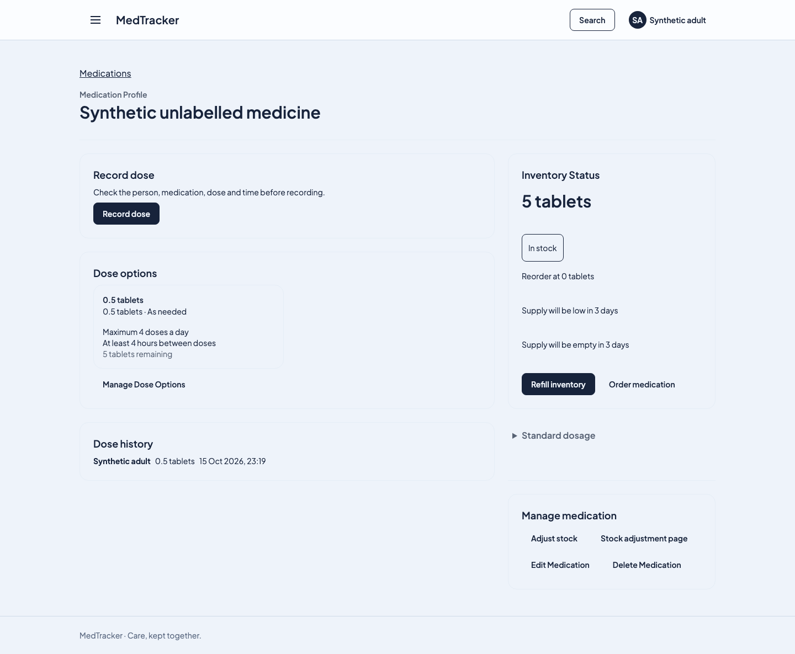
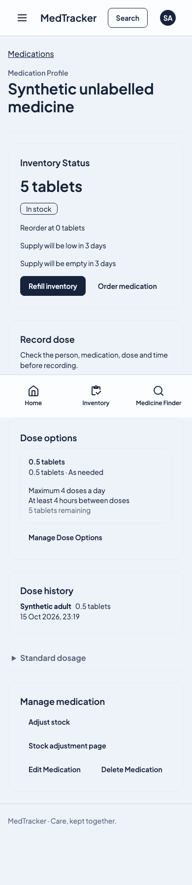

# Household inventory demo

## Overview

This short walkthrough demonstrates medication inventory owned by a household,
with an optional physical storage location. It uses synthetic data only. The
desktop and mobile browser checks passed on 16 October 2026 against the root
Loco application and disposable PostgreSQL fixtures.

The demonstrated outcome is concrete: start with 5.5 tablets, record one dose
of 0.5 tablet, refresh the page, and see 5 tablets plus one saved administration.
No storage location is created automatically.

This is a development demonstration. The wider refactor remains a draft; the
personal-history browser/download checks still fail, and full Rust acceptance
is incomplete. See the [scoped delivery and handoff plan](plans/rust-household-guardrails-20261015.md).

## Walkthrough

Use the isolated browser fixture's account `persistence@example.test` with the
fixture password `password`. These are synthetic development credentials.

1. Sign in and choose **Open Synthetic household**.
2. Choose **Add Medication**. Leave **Location** blank and enter
   **Synthetic unlabelled medicine** as the name.
3. Continue, select **Synthetic adult**, enter a dose of **0.5**, choose
   **tablet**, and choose the as-needed frequency.
4. Review the medication plan, continue, and enter **5.5** as the starting supply.
   Save the medication and choose **Done**.
5. Refresh. The medication page shows **5.5 tablets** in stock.
6. Choose **Record dose**, then confirm **Record dose** in the dialog.
7. Refresh again. Inventory shows **5 tablets** and dose history contains one
   **0.5-tablet** administration for **Synthetic adult**.

The automated check also verifies the saved database state: the location remains
absent, stock is exactly `5.00`, there is exactly one administration, and the
number of storage labels has not changed.

## Desktop and mobile evidence

Desktop, 1440-pixel viewport, after recording the dose and refreshing:



Mobile, 390-pixel viewport, after the same journey:



Both screenshots were inspected. The mobile check also verifies that the page
does not overflow horizontally.

## Household access checks

Four focused request checks passed against the fully booted application:

- Two signed-in sessions keep independent active-household selections. Foreign
  or unknown household targets and revoked membership cannot be selected.
- The home selector rejects invalid CSRF and cross-site requests, saves a valid
  selection, and removes the selector after the last membership is revoked.
- Split cookie headers preserve the maintained browser identity and selection.
- The authorised household can read its stock, while foreign medication,
  assignment and location operations are denied.

Reproduce the existing checks with:

```fish
task slice:test TARGET=requests FILTER=household_select NO_FAIL_FAST=true
task slice:test TARGET=requests FILTER=labelled_stock_still_reads_and_foreign_resources_are_hidden NO_FAIL_FAST=true
```

The first command ran three tests; the second ran one. These are focused
acceptance results, not a complete audit of every tenant boundary.

## Reproduce the browser check

Use the repository's configured tools and a working local container runtime.
The harness creates private fixtures and removes its owned databases afterwards.
Do not point this demonstration at a populated or production database.

```fish
task frontend:test-browser GROUP=care-locations GREP='unlabelled medication'
```

The selected existing test is **unlabelled medication can be created assigned
and taken without an automatic storage label**. It runs once for desktop and
once for mobile; both must execute and pass.

For the captured run, the native Task build completed. Its unconditional browser
installation then stalled before any application checks. After confirming that
the pinned Chromium revision matched the installed cache, the same repository
browser runner completed both checks:

```fish
node scripts/ci/loco-browser.mjs --grep='unlabelled medication' tests/browser/care-locations.spec.mjs
```

That is evidence for the two actual browser journeys, not a claim that the whole
Task prerequisite chain or full application CI passed.

Related documentation: [User management](user-management.md),
[household inventory and personal care decision](adrs/0014-household-inventory-and-personal-care.md).
