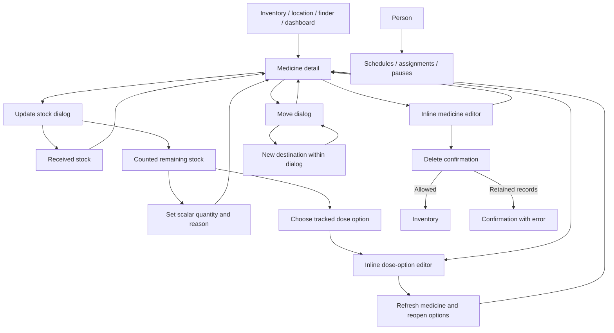

# Medication workflow review — 17 November 2026

The local medicine page now provides one stock entry point, editing within the page,
a Move dialog and dose-option management within its existing section. The browser
journeys use synthetic data with the normal application server and restricted runtime
credentials. Production has not been used for these checks.

## Workflow comparison

| Step | Previous journey | Updated journey | Assessment |
| --- | --- | --- | --- |
| 1. Find a medicine | Inventory, locations, finder and dashboard entry points | Existing entry points lead to the medicine | Navigation retained |
| 2. Receive stock | Refill dialog | Update stock → Received stock | One stock entry point; addition verified |
| 3. Correct a count | Adjustment dialog or separate adjustment page | Update stock → Counted remaining stock | Duplicate page action removed; scalar correction verified |
| 4. Correct option stock | Separate dose-option management | Counted remaining stock → choose tracked option → inline option editor | Uses the correct option operation; correction verified |
| 5. Edit medicine | Management section → edit page | Edit beside medicine name → inline form | Save and Cancel keep the medicine context |
| 6. Delete medicine | Management section → confirmation | Edit → Delete → confirmation | Confirmation retained; clinical retention guard remains in server operation |
| 7. Move medicine | Move page; location also exposed in Edit | Move beside location → destination dialog | One location-changing control in medicine detail; movement verified |
| 8. Create destination | Leave Move for a new-location page | Create destination within Move dialog, then return to destination selection | Creation and subsequent movement verified |
| 9. Manage dose options | Separate list and editor pages | Existing section expands to list/editor | Create, edit and delete verified; summary refreshes after writes |
| 10. Member view | Shared medicine page with management controls gated | Shared page omits management panels and dialogs from its HTML | Member can read stock and record doses; restricted sections absent |
| 11. Personal treatment | Person → Treatments → schedule or assignment | Existing personal treatment journey | Personal plans remain with the person |
| 12. Record current or historical dose | Dashboard, medicine or treatment dose records | Existing recording journeys | Administration rules and history operations remain in their existing handlers |

## Screenshots

Each desktop and mobile pair is from the updated application, captured in the current
browser runs. Dialog captures show the viewport to avoid stitched fixed-header and
backdrop artefacts. Page captures show the full document.

| State | Desktop | Mobile |
| --- | --- | --- |
| Medicine | [View](screenshots/medication-management/medicine-desktop.png) | [View](screenshots/medication-management/medicine-mobile.png) |
| Received stock | [View](screenshots/medication-management/stock-received-desktop.png) | [View](screenshots/medication-management/stock-received-mobile.png) |
| Counted scalar stock | [View](screenshots/medication-management/stock-counted-desktop.png) | [View](screenshots/medication-management/stock-counted-mobile.png) |
| Counted option stock | [View](screenshots/medication-management/stock-option-count-desktop.png) | [View](screenshots/medication-management/stock-option-count-mobile.png) |
| Inline medicine editing | [View](screenshots/medication-management/edit-desktop.png) | [View](screenshots/medication-management/edit-mobile.png) |
| Delete confirmation | [View](screenshots/medication-management/delete-confirmation-desktop.png) | [View](screenshots/medication-management/delete-confirmation-mobile.png) |
| Move | [View](screenshots/medication-management/move-desktop.png) | [View](screenshots/medication-management/move-mobile.png) |
| Create destination | [View](screenshots/medication-management/new-location-desktop.png) | [View](screenshots/medication-management/new-location-mobile.png) |
| Dose options list | [View](screenshots/medication-management/dose-options-desktop.png) | [View](screenshots/medication-management/dose-options-mobile.png) |
| Dose option form | [View](screenshots/medication-management/dose-option-edit-desktop.png) | [View](screenshots/medication-management/dose-option-edit-mobile.png) |
| Member view | — | [View](screenshots/medication-management/member-mobile.png) |

## Findings after implementation

The competing stock-adjustment actions have been consolidated. Editing and moving are
visible beside the medicine identity and location. New destinations and option forms
open within the medicine context. Management form data is fetched only when opened,
through the existing authorised server routes. Successful writes refresh the medicine
data, including stock and dose-option summaries.

The independent agent review identified scalar correction of option stock, stale
summaries after option writes, duplicated Move cancellation and error-focus ordering.
The corrective review also checked stock cancellation, return focus and scanner query
state. These findings were addressed and the reviewer reported no further actionable
findings in the corrective diff.

The dose-option editor is still a long form on mobile. Counted option stock opens that
existing editor, including its dose and timing fields. This preserves the existing
operation while giving us a concrete surface for the owner's next iteration.

Automated accessibility checks and horizontal-overflow assertions run at each captured
state. They supplement visual inspection. Manual screen-reader testing, physical-device
keyboard/viewport behaviour and production browser verification remain outside this
local evidence. The older separate form routes remain usable by direct links.

## Owner checks

- [ ] Find Edit and Move without looking for a management section.
- [ ] Receive three items and check that the quantity increases by three.
- [ ] Count the remaining stock and check that the entered value becomes the total.
- [ ] Try counted stock for a medicine with tracked dose options.
- [ ] Edit a display name, save, reopen and cancel another edit.
- [ ] Open Delete and cancel; check that the medicine name is clear in the confirmation.
- [ ] Move a medicine, creating a destination within the dialog if needed.
- [ ] Add, edit and remove an unused dose option; check that the medicine summary refreshes.
- [ ] Try the page as a household member and compare the available sections.
- [ ] Try mobile scrolling, Tab, Shift+Tab and Escape, particularly focus after closing dialogs.
